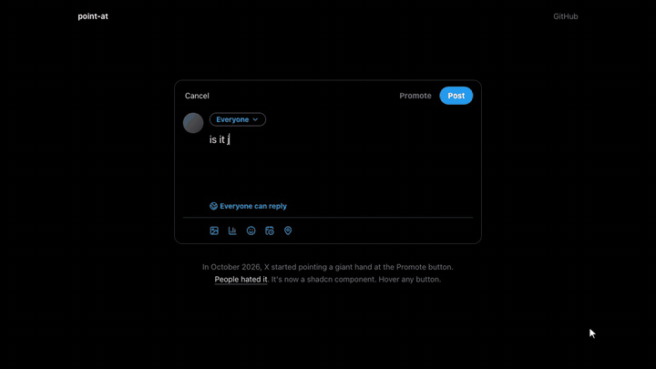

# point-at

The X Promote hand, as a shadcn component. A parody.

In October 2026, X started showing some people a giant suited arm pointing at the Promote button while they wrote a post. This recreates it so you can inflict it on your own users.

[](https://zahlekhan.github.io/point-at/demo.mp4)

**Live:** https://zahlekhan.github.io/point-at/ · [Full video (MP4)](https://zahlekhan.github.io/point-at/demo.mp4)

## Install

```bash
npx shadcn@latest add https://zahlekhan.github.io/point-at/r/point-at.json
```

## Use

```tsx
import { PointAt, PointAtHover, promoteHand } from "@/components/ui/point-at"

<PointAt {...promoteHand} open={open} onOpenChange={setOpen}>
  <Button>Promote</Button>
</PointAt>

// or point at whatever button is hovered
<PointAtHover {...promoteHand}>
  <App />
</PointAtHover>
```

| Prop | Description |
| --- | --- |
| `open`, `onOpenChange` | Controlled visibility (`PointAt`). |
| `target` | Point at an existing element instead of `children`. |
| `selector` | Which hovered elements get pointed at (`PointAtHover`). |
| `src`, `tip` | Hand image and the fingertip position in it, as fractions. Without `src` you get a drawn SVG hand. |
| `armAngle` | Direction the arm runs in the image. The hand slides in along it. |
| `extend` | Repeat the end of the sleeve so the arm always reaches off-screen. For images with a straight sleeve, like `promoteHand`. |
| `angle` | Rotates the whole hand. |
| `size` | Rendered image width (or SVG hand height). Shrinks to fit narrow screens. |
| `delay`, `tap`, `glide` | Entrance delay, keep tapping, slide between targets. |

`promoteHand` loads the image from this site. To self-host, copy `public/hand.webp` and pass `src`.

## The hand

Generated with Gemini via OpenRouter (`scripts/gen-hand.py`), keyed and extended with `scripts/key-hand.py`.

Not affiliated with X.
